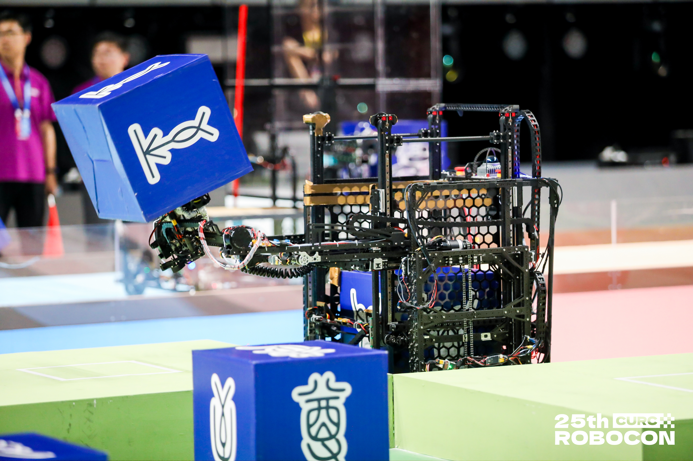
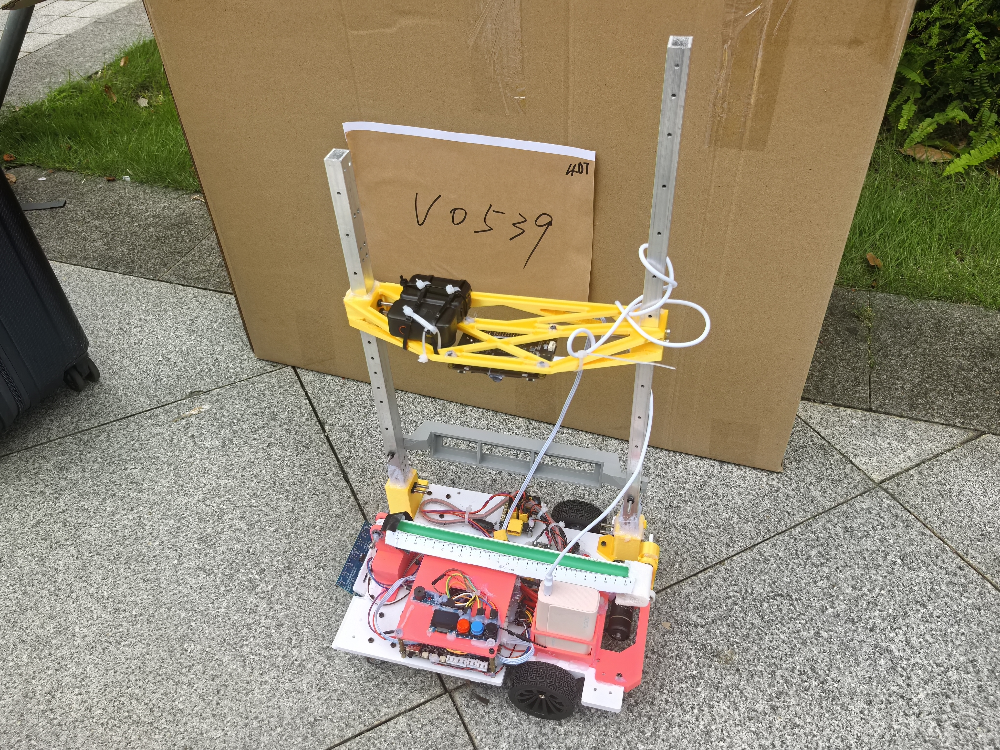

# 张家嘉｜简历附件

**嵌入式软件实习生**

[教育背景](#education) · [竞赛荣誉](#awards) · [项目经历](#projects) · [拓展资料](#extras)

## 教育背景

**广东工业大学｜机器人工程｜本科（2+2）** 
2024.09—2028.06｜GPA：3.2/5｜CET-4 
优秀学生二等奖学金、优秀学生干部奖学金

[学籍证明](evidence/README.md#student-status) · [在校荣誉证明](evidence/README.md#scholarships)

## 竞赛荣誉

| 赛事 | 团队成绩 | 证明 |
|---|---|---|
| ROBOCON 2026 武林探秘 | **全国一等奖** | [查看](evidence/README.md#robocon-2026) |
| ROBOCON 2025 飞身上篮 | **全国二等奖** | [查看](evidence/README.md#robocon-2025) |
| 2026 年全国大学生电子设计竞赛 | **广东赛区省二等奖** | [查看](evidence/README.md#nuedc-2026) |

## 项目经历

### ROBOCON 2026 武林探秘

团队设计两台机器人，协同完成纸箱夹取、运输与摆放。

**本人工作：**负责**四舵轮底盘运动控制、电机接口开发及实车调试**，并参与整车联调。

[实物照片与调试说明](projects/robocon-2026/README.md) · [团队代码仓库](https://github.com/XieFField/RC10_LIB-FrameWork)

### 电子设计竞赛｜车载平衡滚球运动控制系统

两轮差速小车搭载单自由度滚球平衡机构，完成循迹行驶与钢球位置控制。

**本人工作：**负责**整车嵌入式软件、循迹及滚球平衡控制**，参与机械装配与整车联调。

[实物照片与结构说明](projects/nuedc-2026/README.md) · [项目代码](https://github.com/GaGiaa/2026_electronics_design_contest)

## 拓展资料

### 个人项目｜双轮自平衡小车

自行设计、焊接控制 PCB，并完成板卡与整车集成。

[实物照片与控制板说明](projects/balance-car/README.md)

### 个人项目｜四轮移动平台结构设计与装配

独立完成零件建模、设备布局与整机装配建模。

[SolidWorks 装配截图与结构说明](projects/solidworks-platform/README.md)
