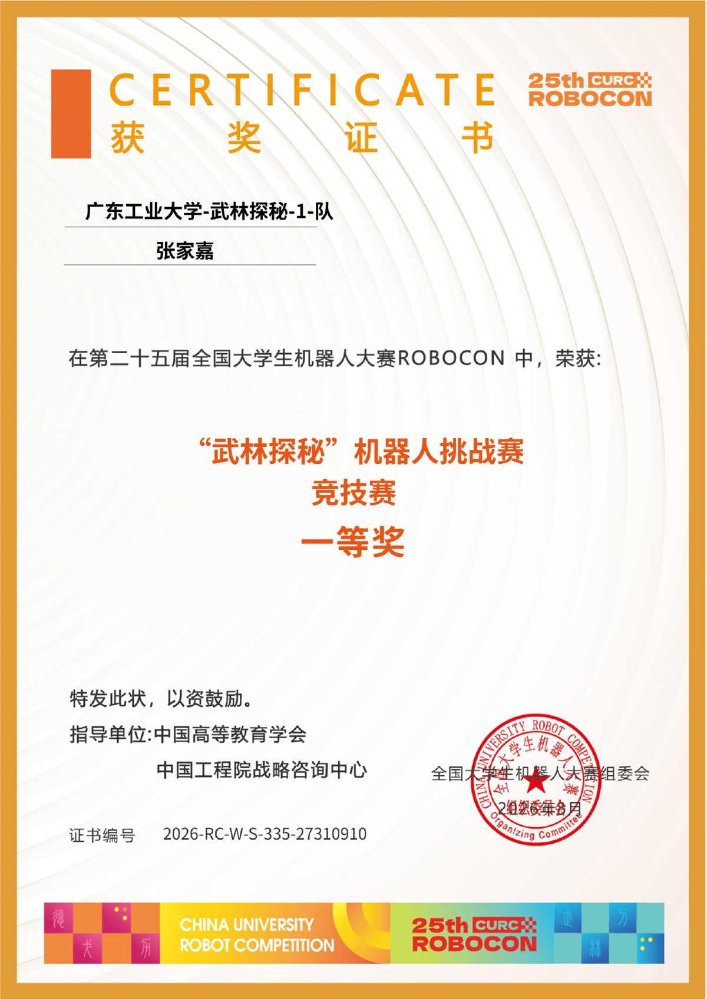
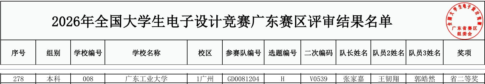
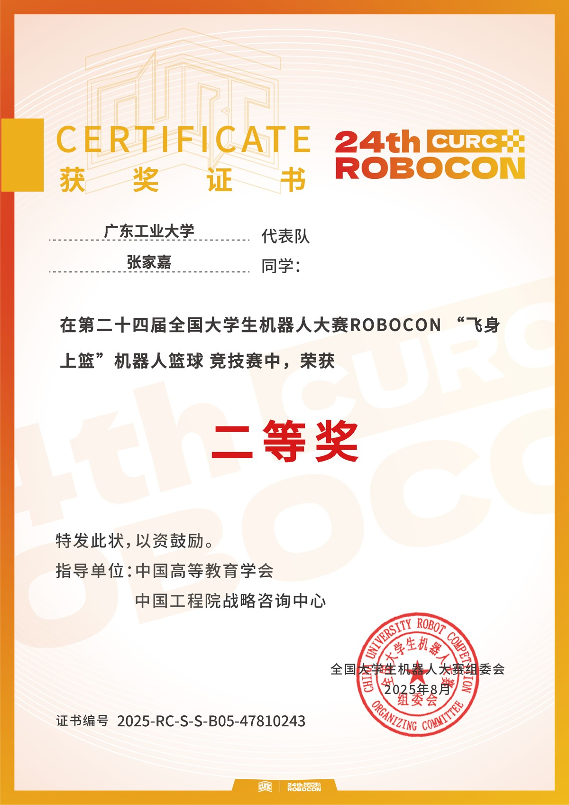
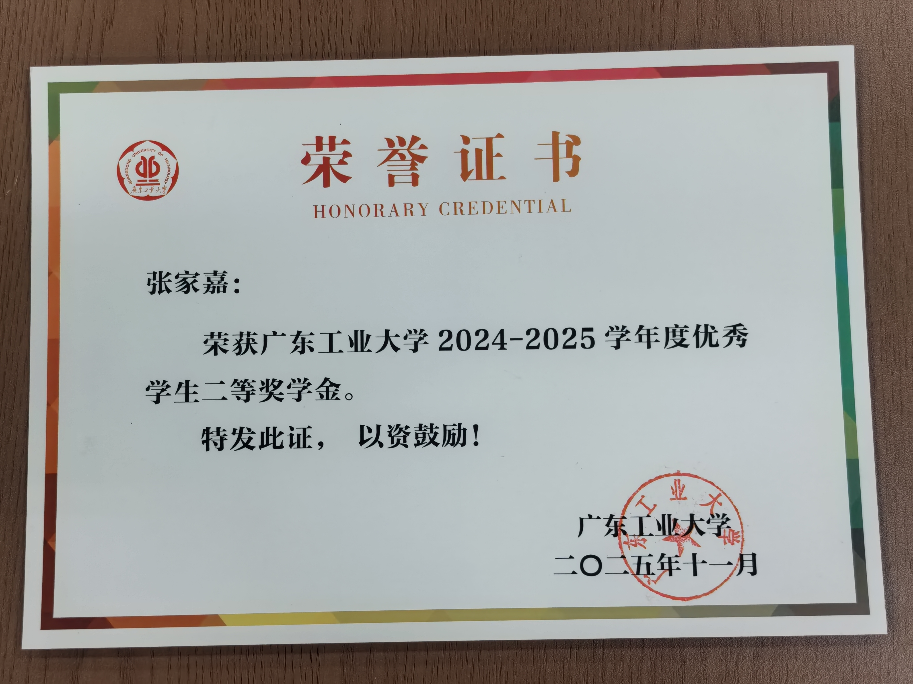
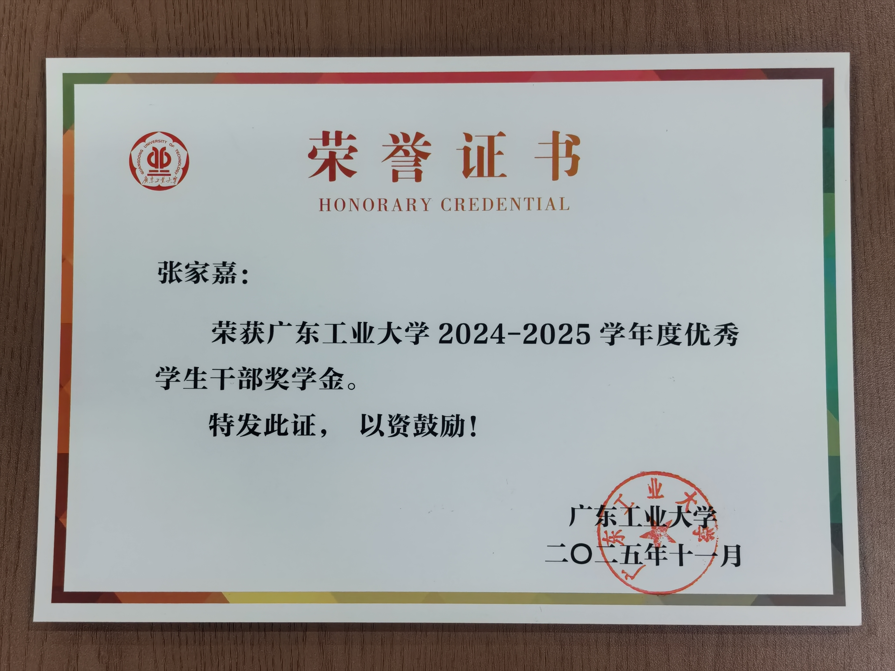

# 证明材料

学籍证明、竞赛获奖证明与在校荣誉原件。

[学籍证明](#student-status) · [竞赛获奖](#competition-awards) · [在校荣誉](#scholarships) · [返回附件首页](../README.md)

## 本科在读学籍证明

广东工业大学｜机器人工程｜普通全日制本科｜在籍（注册学籍）。

报告更新日期：2026-11-01。

[查看学籍报告原件](student-status/%E6%95%99%E8%82%B2%E9%83%A8%E5%AD%A6%E7%B1%8D%E5%9C%A8%E7%BA%BF%E9%AA%8C%E8%AF%81%E6%8A%A5%E5%91%8A_%E5%BC%A0%E5%AE%B6%E5%98%89.pdf)

## 竞赛获奖证明

| 赛事 | 团队成绩 | 证&#8288;明 |
|---|---|---|
| ROBOCON 2026 武林探秘 | **全&#8288;国&#8288;一&#8288;等&#8288;奖** | [查&#8288;看](#robocon-2026) |
| 2026 年全国大学生电子设计竞赛 | **广东赛区 省二等奖** | [查&#8288;看](#nuedc-2026) |
| ROBOCON 2025 飞身上篮 | **全&#8288;国&#8288;二&#8288;等&#8288;奖** | [查&#8288;看](#robocon-2025) |

### ROBOCON 2026 武林探秘｜全国一等奖

广东工业大学-武林探秘-1-队，获奖者张家嘉；对应机器人挑战赛竞技赛。

证书编号：2026-RC-W-S-335-27310910

[查看原件](robocon-2026/%E5%A5%96%E7%8A%B6_%E4%B8%AA%E4%BA%BA_%E4%B8%80%E7%AD%89%E5%A5%96.pdf) · [官方获奖通知](https://www.robocon.org.cn/sys-nd/124.html) · [官方获奖名单](https://download.s21i.co99.net/30049936/0/1/ABUIABA9GAAgh-a30wYowZnG2gI.pdf)

### 2026 年全国大学生电子设计竞赛｜广东赛区省二等奖

广东工业大学，参赛队编号 GD0081204，队长张家嘉。

本人记录：名单第 9 页，序号 278。

第 9 页名单节选，保留标题、表头与本人所在行；完整名单见原件。

[查看原件](nuedc-2026/2026%E5%B9%B4%E5%85%A8%E5%9B%BD%E5%A4%A7%E5%AD%A6%E7%94%9F%E7%94%B5%E5%AD%90%E8%AE%BE%E8%AE%A1%E7%AB%9E%E8%B5%9B%E5%B9%BF%E4%B8%9C%E8%B5%9B%E5%8C%BA%E8%AF%84%E5%AE%A1%E7%BB%93%E6%9E%9C%E5%90%8D%E5%8D%95.pdf) · [官方评审结果通知](https://www2.scut.edu.cn/gduedc/2026/0821/c21363a633626/page.htm) · [官方完整名单](https://www2.scut.edu.cn/_upload/article/files/de/35/faad3b0b46e2b8c1bb7c1cc15fb3/4f44b7c7-522b-40f5-bad7-0443e3531206.pdf)

### ROBOCON 2025 飞身上篮｜全国二等奖

广东工业大学代表队，获奖者张家嘉；对应机器人篮球竞技赛。

证书编号：2025-RC-S-S-B05-47810243

[查看原件](robocon-2025/2025-RC-S-S-B05-47810243.png) · [官方证书查询入口](https://robocon-data.airs.org.cn/) · [官方证书原图](https://robocon-data.airs.org.cn/resources/competition/award/712532000788550.png)

## 在校荣誉

广东工业大学 2024—2025 学年度奖学金。

### 优秀学生二等奖学金

颁发单位：广东工业大学｜获奖者：张家嘉｜落款：2025 年 11 月。

[查看证书原图](scholarships-2024-2025/IMG_20261101_193047.jpg)

### 优秀学生干部奖学金

颁发单位：广东工业大学｜获奖者：张家嘉｜落款：2025 年 11 月。

[查看证书原图](scholarships-2024-2025/IMG_20261101_193103.jpg)

[返回附件首页](../README.md)
