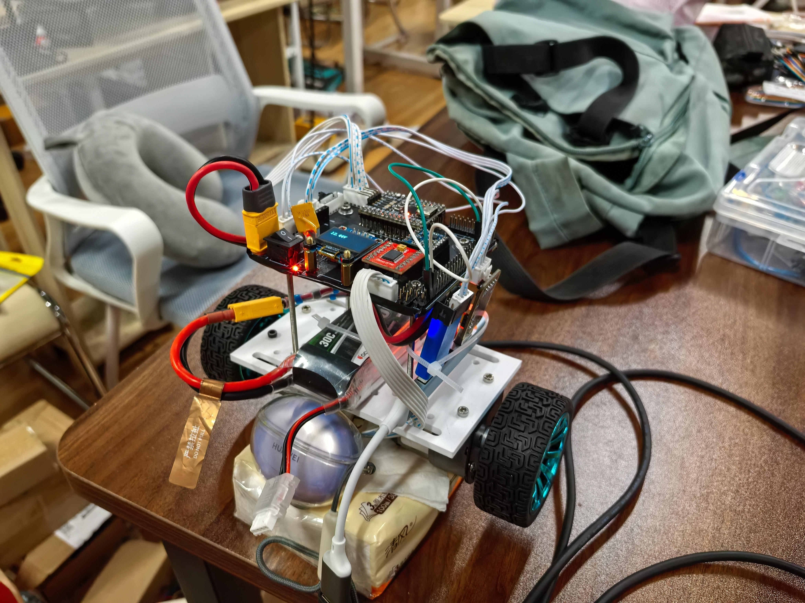
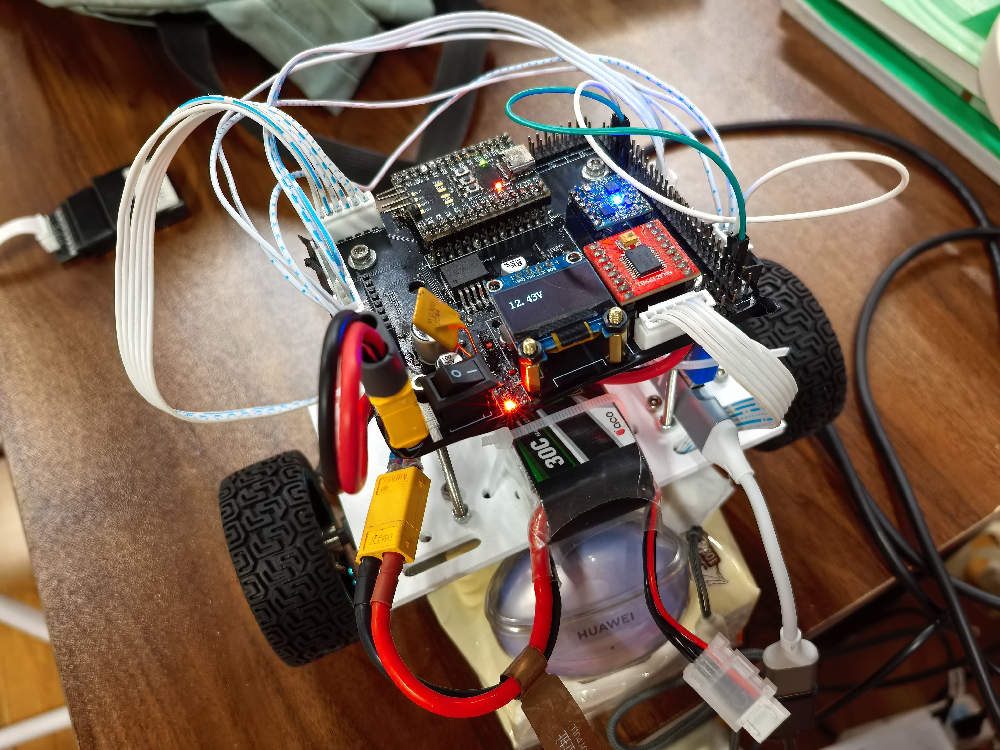
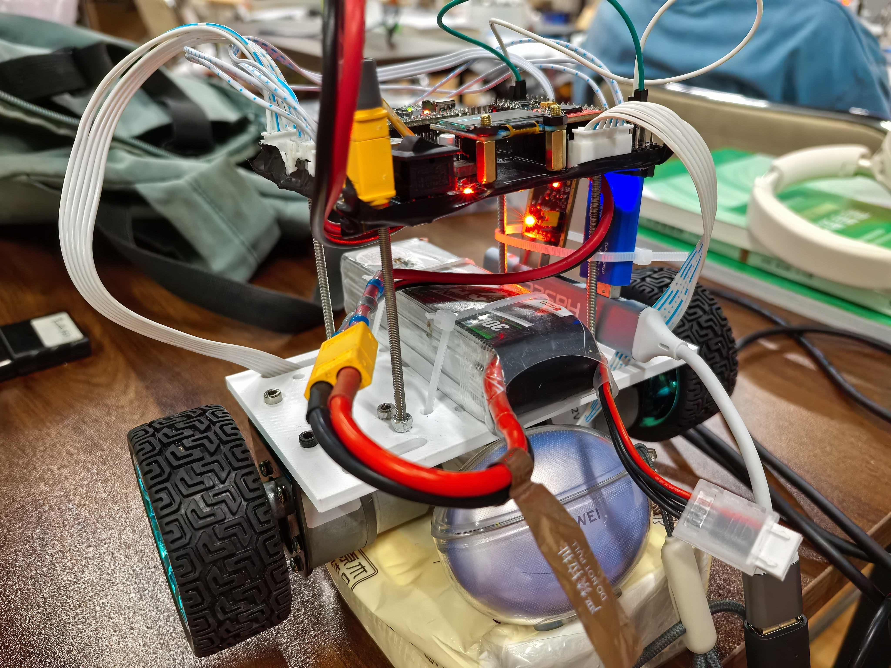

# 个人项目｜双轮自平衡小车

基于双轮直流减速电机制作自平衡小车，个人完成控制 PCB 的原理图设计、布局布线、焊接及上电调试，并将板卡集成到整车中使用。

## 控制板设计与制作

自行设计并焊接控制 PCB，完成电源与外设接口连接，集成显示、电机驱动及传感器等模块，开展上电检查与整机调试。

## 1. 整车总览

展示双轮底盘、上下层结构及控制板在整车中的安装关系。

[查看大图](images/IMG_20250723_210258.jpg)

## 2. 控制板与外设接口

展示控制板、插接模块、接插件、显示与供电连接。

[查看大图](images/IMG_20250723_210119.jpg)

## 3. 板卡安装与整机连接

侧面展示板卡安装、层间空间、电机及线束连接。

[查看大图](images/IMG_20250723_210135.jpg)

[返回简历附件首页](../../README.md)
