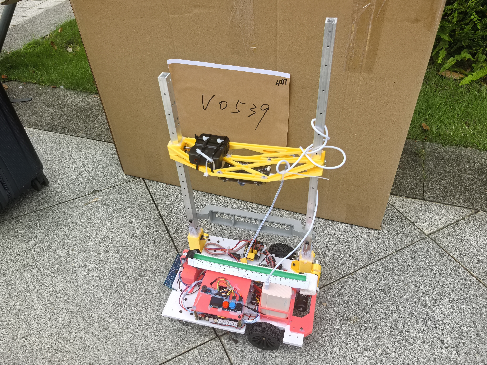
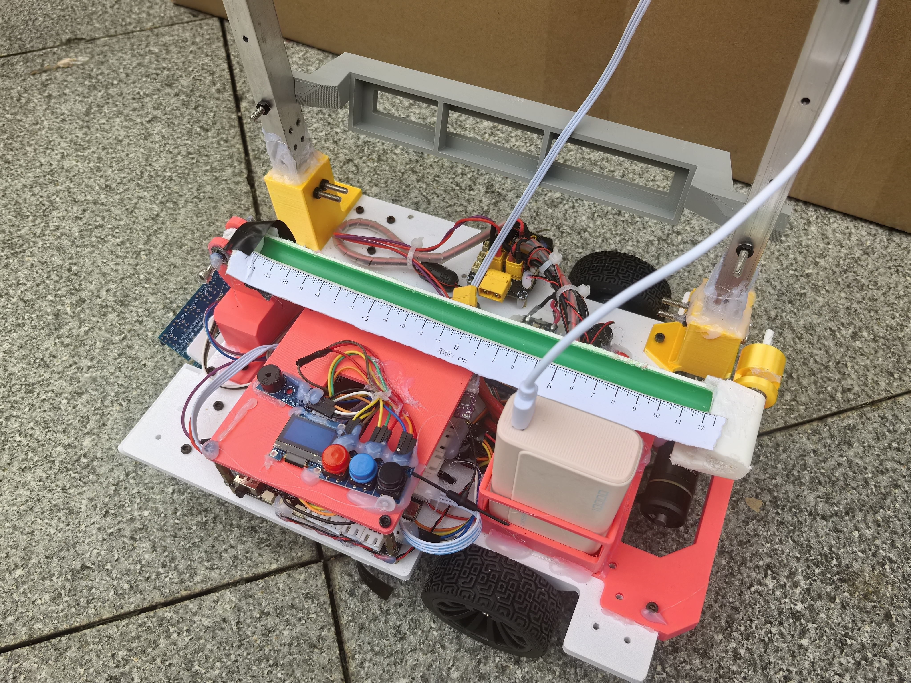
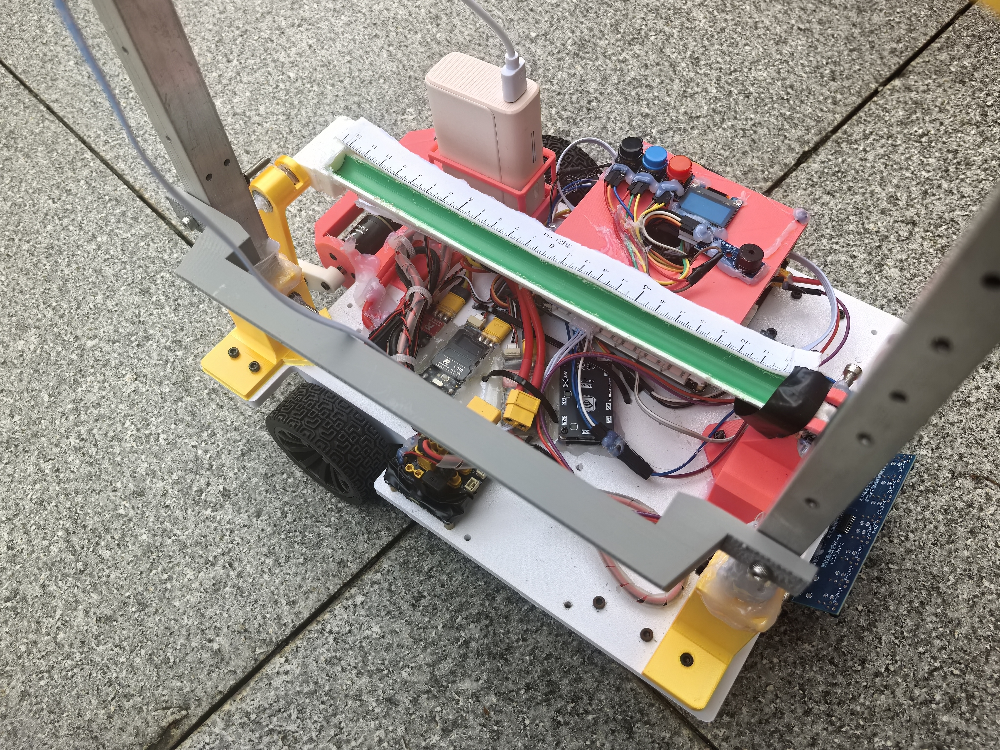
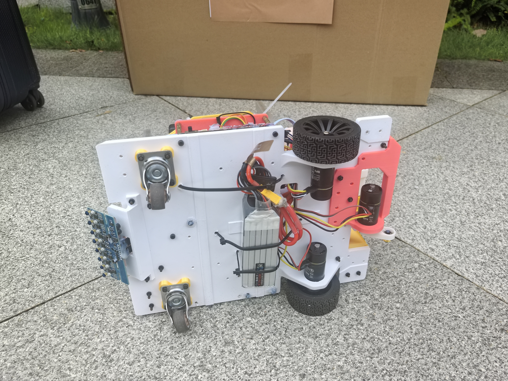

# 电子设计竞赛｜车载平衡滚球运动控制系统

两轮差速小车搭载单自由度滚球平衡机构，完成循迹行驶与钢球位置控制。

## 个人工作

本人负责整车嵌入式软件开发、循迹控制及滚球平衡控制，同时参与机械装配、FDM 打印切片与参数调整，以及整车联调。

配合队友完成零部件装配与紧固，并结合调试需求辅助调整安装位置。

## 项目图片

### 1. 整车总览

展示两轮差速底盘、滚球管道及上方支架的整车布置。

[查看原图](images/IMG_20260805_133159.jpg)

### 2. 滚球机构与操作界面

展示滚球管道、刻度尺、显示屏和按键的安装布置。

[查看原图](images/IMG_20260805_133205.jpg)

### 3. 电控布置与线束连接

展示底盘内部电控安装、电源连接与线束布置。

[查看原图](images/IMG_20260805_133218.jpg)

### 4. 底盘底部与循迹传感器

展示底部驱动电机、车轮、万向轮及灰度传感器的安装。

[查看原图](images/IMG_20260805_133239.jpg)

## 相关链接

[项目代码](https://github.com/GaGiaa/2026_electronics_design_contest) · [返回简历附件首页](../../README.md)
