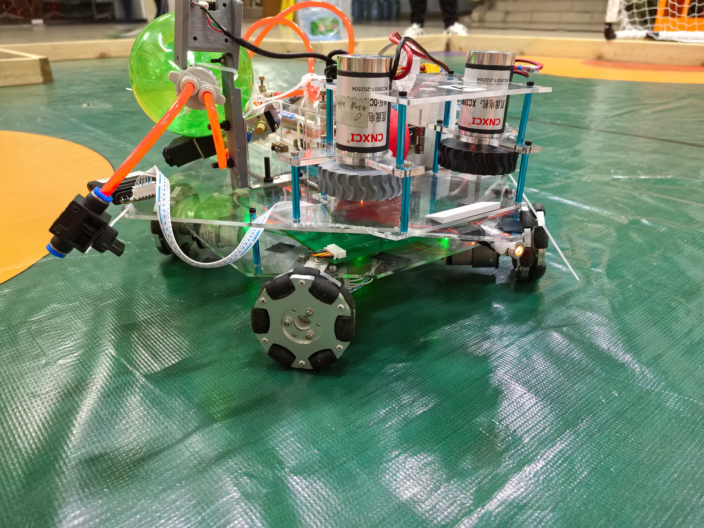
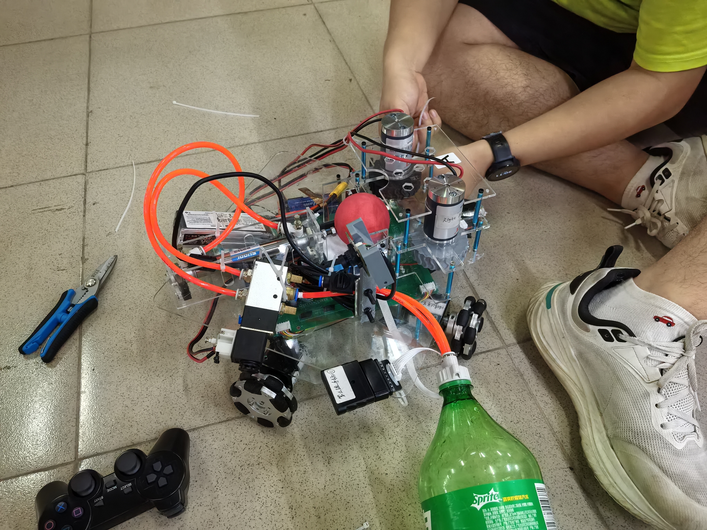
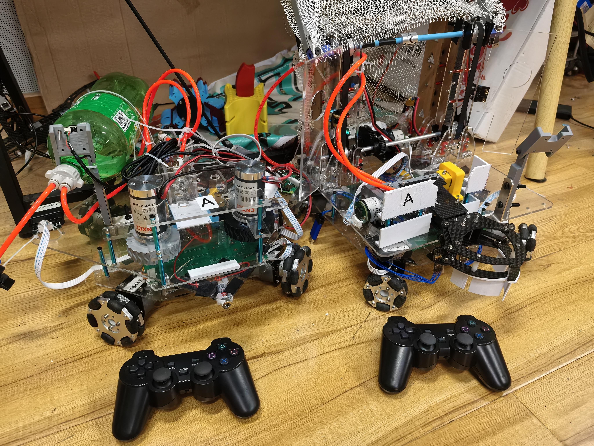
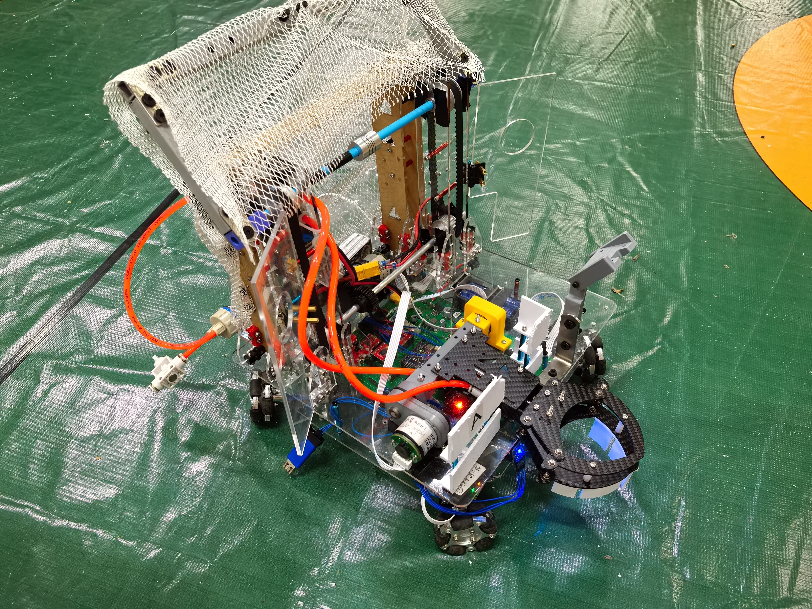

# ROBOCON 2025 校内选拔赛

**机器人电控｜拓展项目**

10 人团队合作设计制作两台机器人，本人负责其中一台机器人的电控开发，包括外设驱动编写、电机控制及整车电控调试。

[实车演示](#demonstration) · [项目图片](#photos) · [返回简历附件首页](../../README.md#extras)

## 个人工作

- 编写 OLED 显示与 PS2 手柄通信驱动，实现状态显示与遥控指令接收。
- 完成直流减速电机驱动与控制，实现车辆遥控操作。
- 配合机械队友开展整车电控调试与联调。

## 实车演示

### 底盘转向与车体运动 · 8.8 秒

展示本人负责车辆的底盘转向与车体运动。

https://github.com/user-attachments/assets/9f8d8880-64d1-4b3b-ba3e-a892e3c0c44b

[查看全部 8 段演示与开发记录](videos/README.md)

## 项目图片

### 1 · 本人负责车辆的整车实物

本人负责该车的电控开发；图中可见底盘、上层双竖直电机及机构布置。

### 2 · 装配与调试现场

展示同一台车辆的另一侧设备布置与现场调试状态。

### 3 · 团队双车合照

团队制作的两台机器人。本人负责左侧车辆的电控，右侧为团队另一台机器人。

补充图片 · 团队另一台机器人

作为团队双车系统的补充实物记录。

## 相关链接

[全部视频与开发记录](videos/README.md) · [返回简历附件首页](../../README.md#extras)
