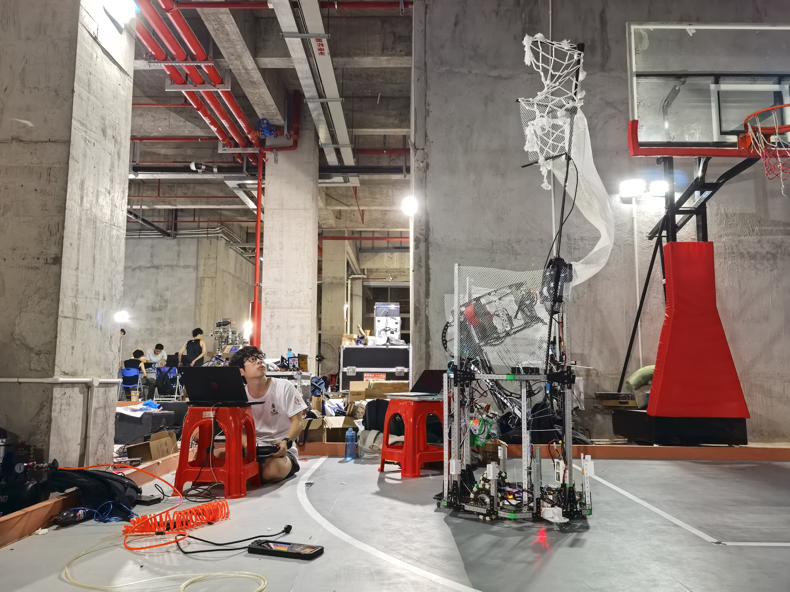
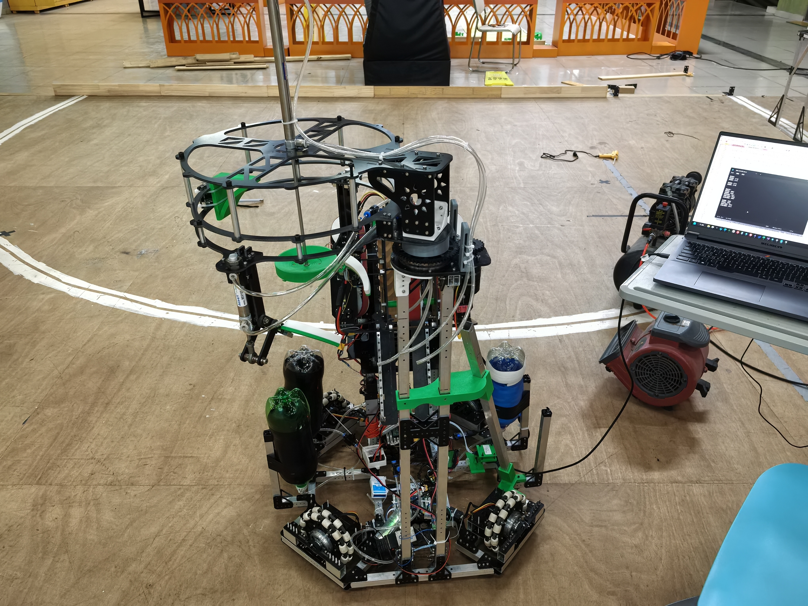
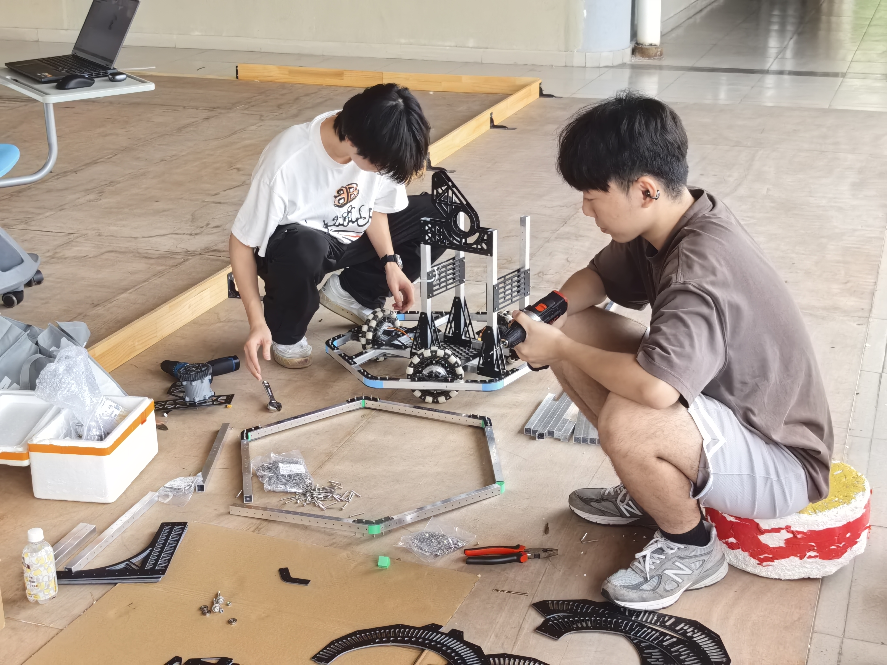
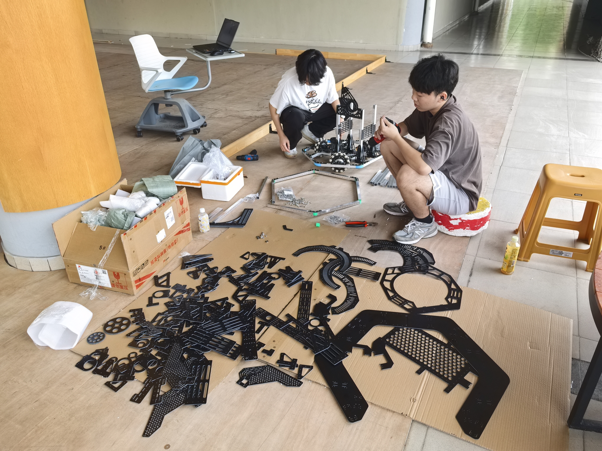

# ROBOCON 2025 飞身上篮

**三全向轮底盘控制｜拓展项目**

基于团队已有车辆与电控框架，负责三全向轮底盘运动控制及部分外设驱动开发，并参与机械装配与整车联调。

[项目图片](#photos) · [全国二等奖证明](../../evidence/README.md#robocon-2025) · [返回简历附件首页](../../README.md#extras)

## 个人工作

- **底盘运动控制**：完善三全向轮底盘运动学解算，编写电机速度闭环 PID，并通过串口波形开展参数整定。
- **速度规划**：加入梯形、S 型速度规划，处理底盘运动指令的加减速过程。
- **遥控通信**：实现航模遥控器 CRSF 协议的解码与编码。
- **状态指示驱动**：采用 SPI 配合 DMA 实现板载 WS2812 指示灯珠驱动。
- **装配与联调**：参与机器人机械装配，配合完成整车联调。

## 项目图片

以下照片涵盖团队不同车辆及同一车辆的不同开发阶段。

### 1 · 本人负责底盘控制的机器人

展示机器人在场地中的调试状态。本人负责该车的三全向轮底盘运动控制、速度规划及相关外设驱动。

### 2 · 团队车辆开发阶段实物

展示团队车辆在开发阶段的底盘、上层机构与设备布置。

### 3 · 机械装配过程近景

本人参与的机械装配过程，展示底盘与结构件的装配。

补充图片 · 机械装配过程全景

从全景视角补充展示零部件与装配现场。

## 相关链接

[全国二等奖证明](../../evidence/README.md#robocon-2025) · [返回简历附件首页](../../README.md#extras)
