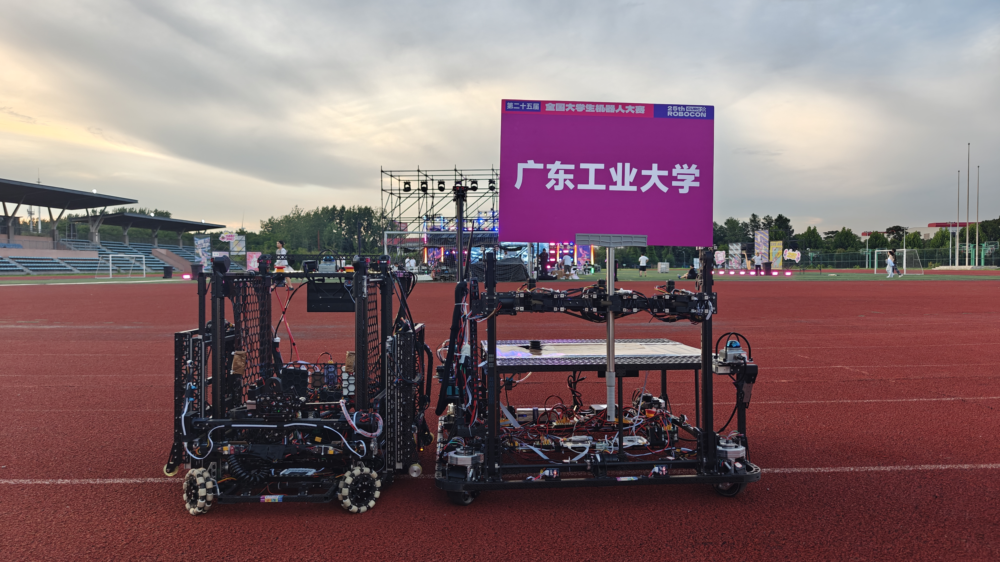
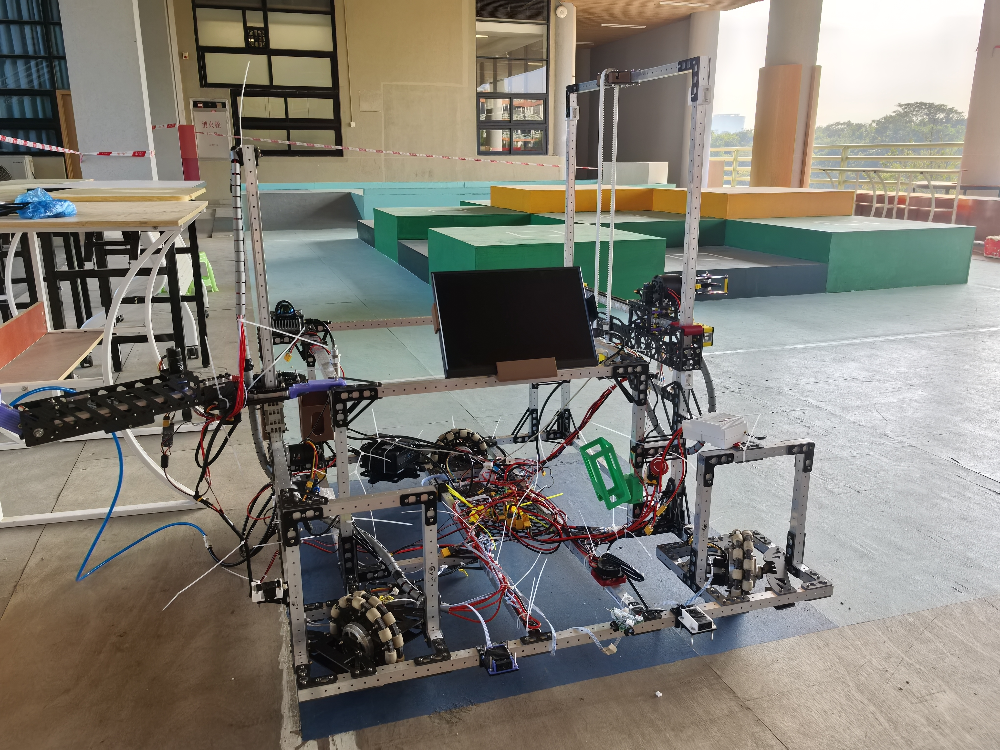
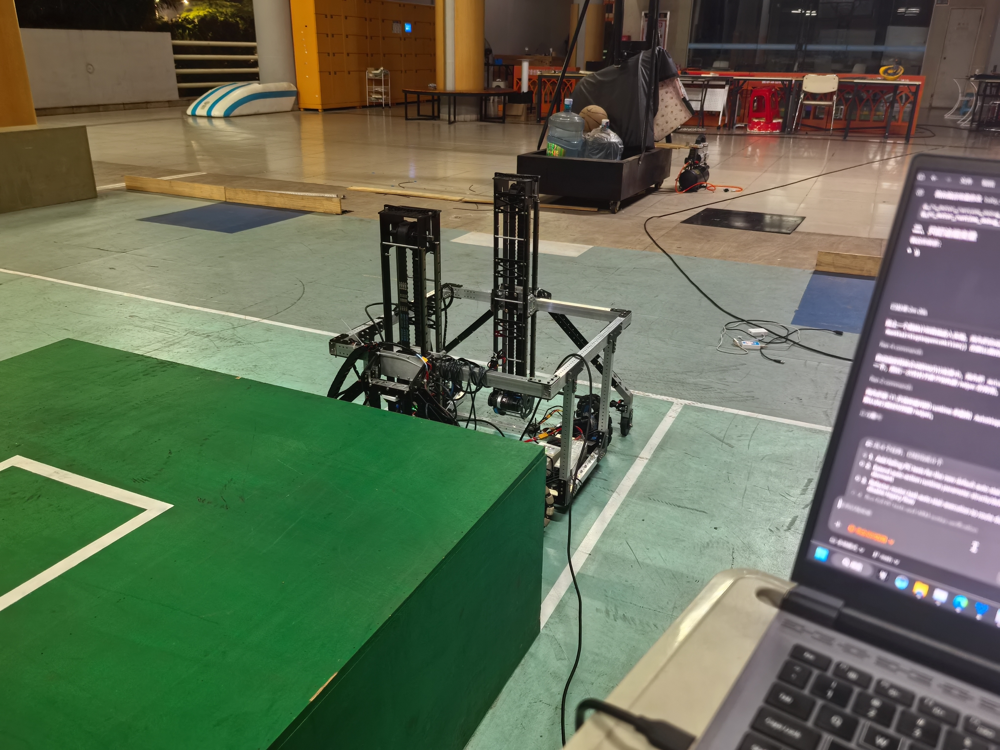
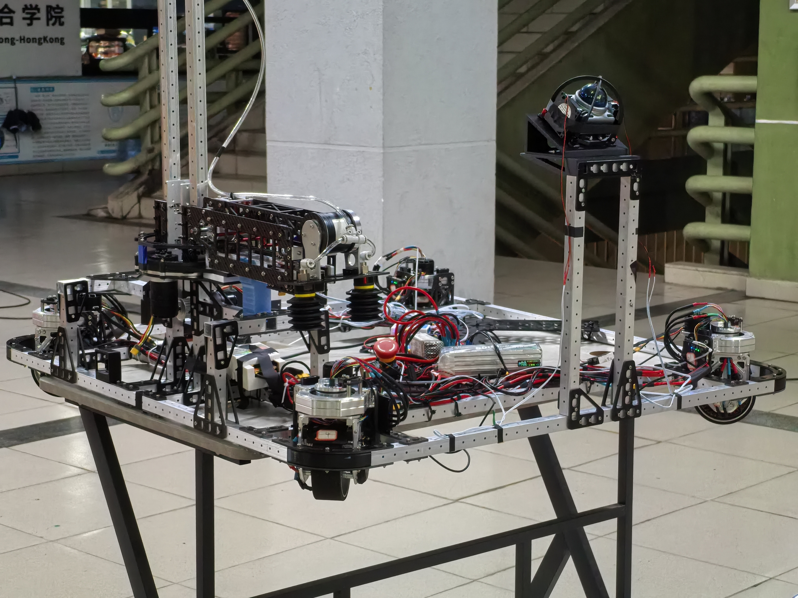
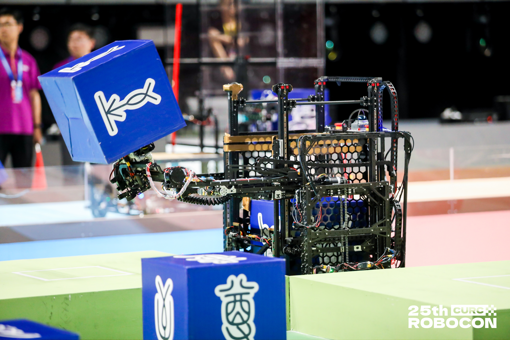
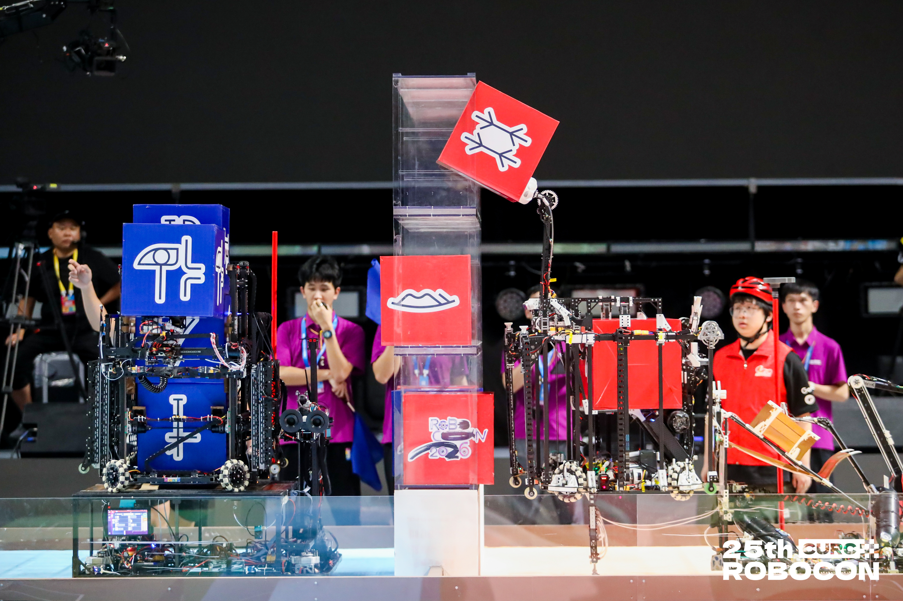

# ROBOCON 2026｜整机迭代与实车调试

本组照片展示团队两台机器人在不同开发阶段及比赛现场的实物形态，涵盖底盘与机构迭代、电控布置和场地调试。本人负责底盘运动控制、电机接口开发及实车调试，并参与整车联调。

## 1. 团队车辆总览

团队两台机器人并排展示，背景屏幕显示广东工业大学。

[查看原图](images/mmexport1784216561168.jpg)

## 2. 开发阶段车辆实物

开发环境中的车辆实物，可见机构、轮系与线束布置。

[查看原图](images/IMG_20251227_153042.jpg)

## 3. 场地调试过程

车辆在场地中的调试画面，电脑位于前景。

[查看原图](images/IMG_20260429_044216.jpg)

## 4. 四舵轮底盘与电控布置

展示四舵轮底盘、框架、电控与上层机构的整机布置。

[查看原图](images/IMG_20260521_210117.jpg)

## 5. 比赛现场：纸箱夹取作业

比赛现场车辆夹持蓝色纸箱的作业画面。

[查看原图](images/mmexport6912a338036a4c814a39431d95e1b26b_1784345.jpeg)

## 6. 比赛现场：任务执行场景

比赛现场多台车辆与任务装置的全景。

[查看原图](images/mmexport173eadf5e5a0c88b11b9541102515900_1784345.jpeg)

[团队代码仓库](https://github.com/XieFField/RC10_LIB-FrameWork) · [返回简历附件首页](../../README.md)
