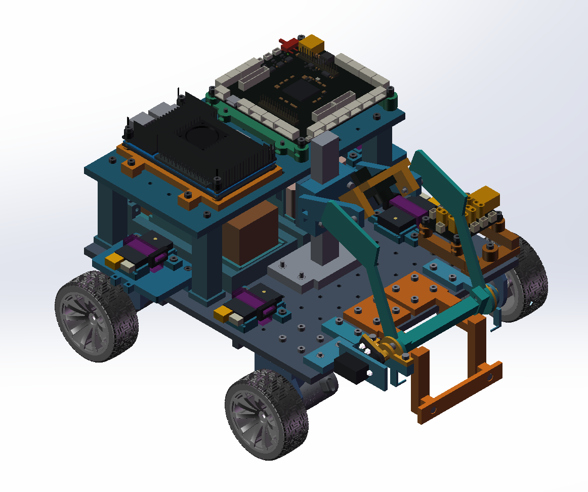
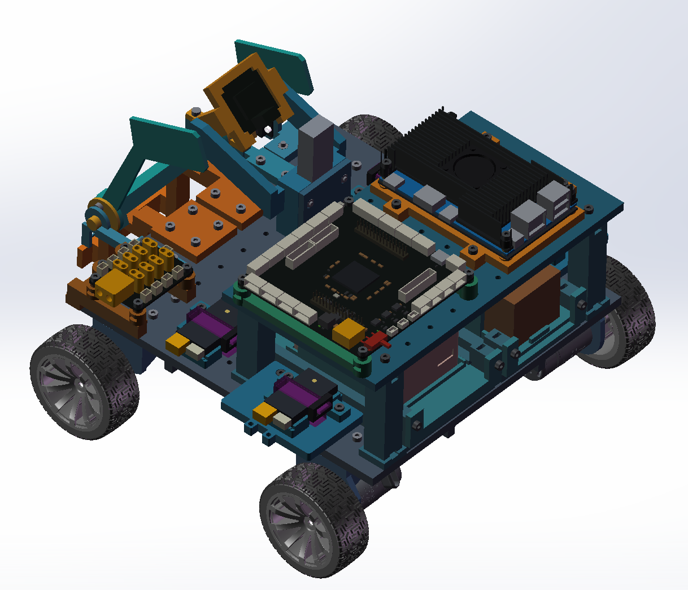
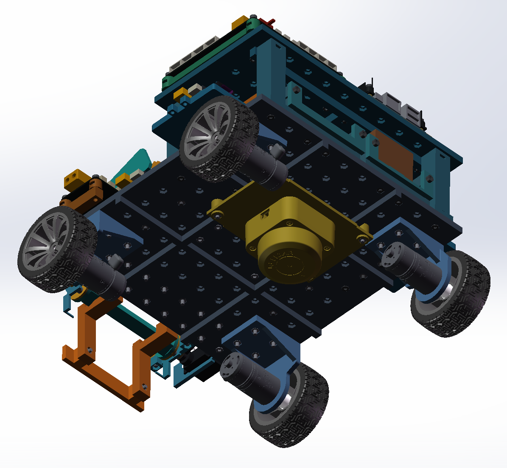

# 个人项目｜四轮移动平台结构设计与装配

为提升 SolidWorks 零件设计与装配能力开展的个人项目。

## 个人工作

独立完成四轮移动平台的零件建模、设备布局与整机装配建模。模型包含底盘、分层支撑、设备安装结构及前部机构，结合电机、车轮、板卡与紧固件的安装关系完成整机布局。

## 项目图片

### 1. 整机装配总览

整机前侧斜视图，展示整车构型、分层结构、前部机构与设备安装关系。

[查看原图](images/Snipaste_2026-11-02_09-51-18.png)

### 2. 设备布局与安装结构

另一侧上方视图，展示板卡布局、分层支撑、设备安装结构与连接紧固件。

[查看原图](images/Snipaste_2026-11-02_09-51-49.png)

### 3. 底盘与底部装配

底部斜视图，展示底盘、驱动电机、车轮及底部设备的安装关系。

[查看原图](images/Snipaste_2026-11-02_09-52-06.png)

## 相关链接

[返回简历附件首页](../../README.md)
